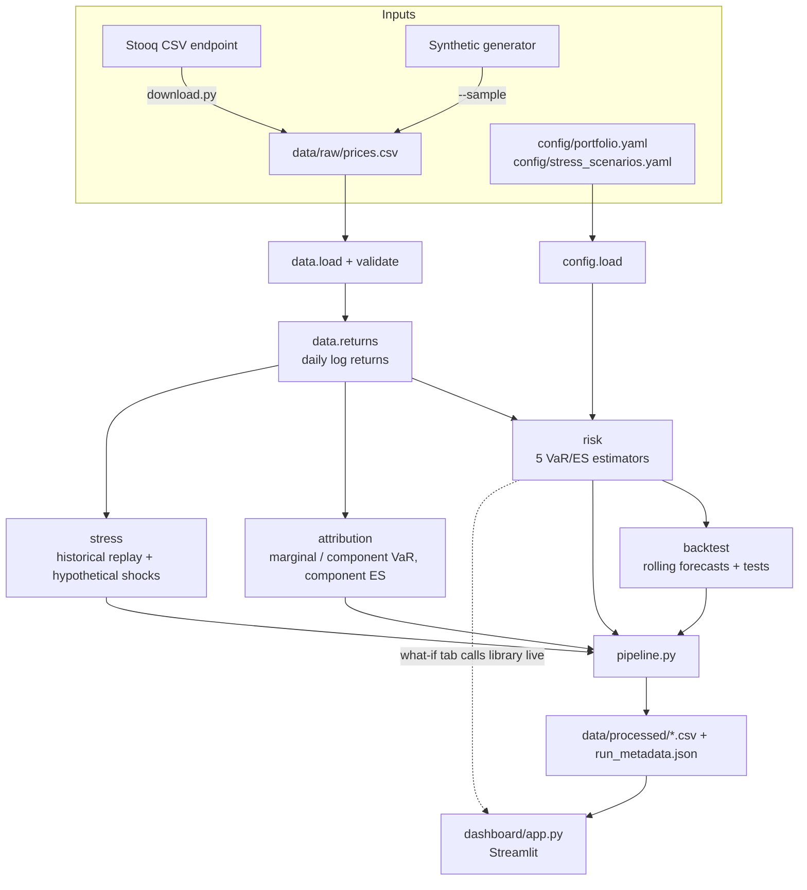

# Architecture

This document describes how Market Risk Engine is put together: the modules, what each one owns, the
data that flows between them, and the rules that keep the risk maths correct. It is the design; once
code exists, the code is the source of truth and this file is updated to match it.

Status: **design, pre-implementation.** Module and function names below are the planned ones.

---

## 1. The big picture

The engine is a one-way pipeline. Prices go in at the top; VaR/ES numbers, backtests, attribution and
stress results come out at the bottom and are written to disk. The dashboard only reads those outputs
(plus calls the library directly for the live what-if tab). Nothing downstream ever reaches back up.



---

## 2. Repository layout

```
market-risk-engine/
├── config/
│   ├── portfolio.yaml            # tickers, weights, notional, windows, confidence levels, seed
│   └── stress_scenarios.yaml     # historical windows + illustrative factor shocks
├── data/
│   ├── raw/.gitkeep              # prices.csv lands here (git-ignored)
│   └── processed/.gitkeep        # pipeline outputs (git-ignored)
├── src/riskengine/
│   ├── __init__.py               # version + public API re-exports
│   ├── config.py                 # dataclasses + YAML loading + validation
│   ├── conventions.py            # sign rule, horizon scaling, shared constants
│   ├── download.py               # Stooq downloader: python -m riskengine.download
│   ├── data/
│   │   ├── load.py               # read prices.csv, align dates, validate
│   │   ├── returns.py            # prices -> log returns, portfolio P&L
│   │   └── synthetic.py          # regime-switching, fat-tailed sample data
│   ├── risk/
│   │   ├── base.py               # RiskEstimate dataclass, Estimator protocol, registry
│   │   ├── historical.py
│   │   ├── parametric.py         # normal + Student-t
│   │   ├── ewma.py               # RiskMetrics vol + filtered historical simulation
│   │   └── montecarlo.py         # multivariate normal + t-copula
│   ├── backtest/
│   │   ├── rolling.py            # out-of-sample forecast loop (no look-ahead)
│   │   └── tests.py              # Kupiec POF, Christoffersen, conditional coverage, traffic light
│   ├── attribution/
│   │   └── components.py         # marginal VaR, component VaR, component ES
│   ├── stress/
│   │   ├── historical.py         # replay named windows on today's weights
│   │   └── hypothetical.py       # factor shocks from config (illustrative)
│   ├── pipeline.py               # python -m riskengine.pipeline [--sample]
│   └── dashboard/
│       └── app.py                # streamlit run src/riskengine/dashboard/app.py
├── tests/                        # pytest, mirrors src/ layout
├── docs/
│   ├── ARCHITECTURE.md           # this file
│   └── PRD.md                    # what we are building and why
├── .github/workflows/ci.yml
├── Makefile
├── pyproject.toml
└── README.md
```

**Why `src/riskengine/` and not a package called `src`:** a package named `src` works for
`python -m src.pipeline`, but it can't be installed cleanly, clashes with other projects and reads as a
beginner layout. A real package name with the standard `src/` layout means `pip install -e .` works,
tests import the installed package (so packaging bugs are caught), and commands read
`python -m riskengine.pipeline`.

---

## 3. Layering rules

Each layer may import only from layers above it in this list. A small AST-based test enforces this so
the rule can't drift.

| Layer | Modules | May import | Does I/O? |
|---|---|---|---|
| 0. Foundations | `config`, `conventions` | stdlib, numpy, pandas, yaml | reads config files only |
| 1. Data | `data.*`, `download` | layer 0 | yes (prices, network) |
| 2. Risk maths | `risk.*` | layer 0 | **no** |
| 3. Analytics | `backtest.*`, `attribution.*`, `stress.*` | layers 0, 2 | **no** |
| 4. Orchestration | `pipeline` | layers 0–3 | yes (writes outputs) |
| 5. Presentation | `dashboard.app` | layers 0–4 | reads outputs |

In plain terms:

- **The maths never touches files or the network.** Every function in `risk`, `backtest`, `attribution`
  and `stress` takes arrays/DataFrames and returns numbers. That makes them easy to unit-test against
  known answers.
- **The dashboard never re-implements maths.** It reads pipeline outputs, and the what-if tab calls the
  same `risk` functions the pipeline uses. One formula, one place.

---

## 4. Conventions (enforced in code)

These live in `conventions.py` and are tested, because getting a sign or a date wrong is the most
common way risk numbers end up silently wrong.

| Topic | Rule |
|---|---|
| Asset returns | Daily **log returns**, `r_t = ln(P_t / P_{t−1})`, from adjusted closes. |
| Portfolio return | **Linear aggregation:** `r_p,t = Σ_i w_i · r_i,t`. Portfolio P&L in $ = `notional · r_p,t`. |
| Loss | `loss = −P&L`. |
| VaR / ES | Always **positive loss amounts**, reported both in $ and as % of notional. `ES ≥ VaR` is asserted. |
| Confidence levels | α ∈ {0.95, 0.99} (configurable). |
| Horizons | 1-day computed directly; 10-day = 1-day × √10. Assumes i.i.d. returns; every 10-day number carries this caveat in outputs and the dashboard. |
| Estimation window | 500 trading days by default (configurable). |
| No look-ahead | The forecast **for** day t uses returns up to and including t−1 only. |
| Randomness | One seed in config; every Monte Carlo run and the synthetic generator take an explicit `numpy.random.Generator`. |

**About the linear aggregation choice.** Summing weighted *log* returns is a first-order approximation
of the true portfolio return (the error is about r²/2, a few basis points on a normal day). We use it
because it makes the portfolio a linear function of the asset returns, so the parametric VaR,
attribution (components sum exactly to the total) and the backtest all use **the same definition of
P&L**. Comparisons between methods are therefore like-for-like. Exact revaluation
(`Σ w_i (e^{r_i} − 1)`) is a documented option for later, not the default.

---

## 5. Data layer

### 5.1 Prices file contract (`data/raw/prices.csv`)

| Column | Type | Notes |
|---|---|---|
| `Date` | ISO date | strictly increasing, unique, business days |
| one column per ticker | float > 0 | adjusted close |

Both the real downloader and the synthetic generator write exactly this format, so everything
downstream is source-agnostic.

### 5.2 Loading and validation (`data/load.py`)

`load_prices(path, tickers) -> pd.DataFrame` (DatetimeIndex × tickers) and fails loudly on:
missing tickers, non-positive or non-numeric prices, duplicate or unsorted dates, gaps longer than a
configurable number of days. It keeps only the **common date range** where every ticker has a price.
It never forward-fills silently; any filling is reported.

> **Real-data note:** the common history starts when the youngest ETF began trading. For the default
> universe that is expected to be HYG (around April 2007; to be confirmed from the downloaded file).
> With a 500-day window, out-of-sample backtests start roughly two years after that.

### 5.3 Real download (`download.py`)

`python -m riskengine.download [--tickers ...] [--out data/raw/prices.csv]`. Fetches
`https://stooq.com/q/d/l/?s=<ticker>.us&i=d` per ticker with `urllib`, parses with pandas, merges on
date. Parsing is split from fetching so it can be unit-tested on a fixture CSV with no network.
Open question to check on the first real run: whether Stooq's close is dividend-adjusted for every
ETF (it matters for bond ETFs like TLT/HYG).

### 5.4 Synthetic data (`data/synthetic.py`)

`generate_prices(tickers, start, end, rng) -> pd.DataFrame`. Business days 2005–2024; correlated
asset returns from a fixed block correlation structure (equities, rates, credit, commodities);
a two-state (calm/stressed) volatility regime; Student-t shocks for fat tails; a few injected stress
episodes. Output is flagged `synthetic=True` in run metadata and triggers a banner in the dashboard
and README instructions.

---

## 6. Risk layer

### 6.1 Shared types (`risk/base.py`)

```python
@dataclass(frozen=True)
class RiskEstimate:
    method: str            # "historical", "normal", "student_t", "ewma_fhs", "mc_normal", "mc_t_copula"
    alpha: float           # e.g. 0.99
    horizon_days: int      # 1 or 10
    var_pct: float         # positive loss as fraction of notional
    es_pct: float          # positive, >= var_pct
    var_usd: float
    es_usd: float
    window_start: date     # first return used
    window_end: date       # last return used (the forecast is for the next day)
    diagnostics: dict      # e.g. {"nu": 4.8} for Student-t, {"sigma_now": ...} for EWMA

class Estimator(Protocol):
    name: str
    def estimate(self, returns: pd.DataFrame, weights: pd.Series, alpha: float) -> tuple[float, float]:
        """Return (VaR, ES) as positive fractions of notional for 1 day,
        using ONLY the rows in `returns` (the caller controls the window)."""
```

Every estimator is a pure function of a window of asset returns and the weights. The caller
(pipeline or backtest) decides which rows are in the window, which is what makes "no look-ahead"
a property of one place in the code (`backtest/rolling.py`) instead of five.

A small registry (`ESTIMATORS = {"historical": ..., ...}`) lets the pipeline, backtest and dashboard
loop over methods by name.

### 6.2 Methods

| Method | Module | 1-day VaR | 1-day ES |
|---|---|---|---|
| Historical simulation | `historical.py` | empirical α-quantile of the window's portfolio losses | mean of losses ≥ VaR |
| Parametric normal | `parametric.py` | `z_α σ_p − μ_p`, `σ_p = √(wᵀΣw)` | `σ_p φ(z_α)/(1−α) − μ_p` |
| Parametric Student-t | `parametric.py` | `−μ + s·t_ν⁻¹(α)`, with `s = σ_p √((ν−2)/ν)` so the variance matches | `−μ + s · f_ν(t_α)/(1−α) · (ν + t_α²)/(ν−1)` |
| EWMA / filtered HS | `ewma.py` | per-asset RiskMetrics vol, λ = 0.94: `σ²_t = λσ²_{t−1} + (1−λ)r²_{t−1}`; returns are divided by their vol at the time and rescaled by today's vol, then historical VaR on the rescaled P&L | same, on rescaled losses |
| Monte Carlo | `montecarlo.py` | simulate N scenarios (default 20,000) from multivariate normal (μ, Σ) or a t-copula with empirical marginals; VaR = quantile of simulated losses | mean of simulated losses ≥ VaR |

Implementation notes:

- Student-t ν is fitted by maximum likelihood on the window's portfolio returns, with ν bounded
  above 2 so the variance exists. ν is reported in `diagnostics`.
- EWMA variance is seeded with the sample variance of the first 30 days of the window, so the
  recursion never sees data from outside the window.
- Monte Carlo takes the `Generator` explicitly; same seed → same numbers.
- 10-day numbers come from `conventions.scale_horizon(estimate, 10)`, never from inside an estimator.

---

## 7. Backtest layer

### 7.1 Rolling forecasts (`backtest/rolling.py`)

```python
def rolling_forecasts(returns, weights, estimator, alpha, window=500) -> pd.DataFrame:
    # for each day t from `window` to the end:
    #     hist = returns.iloc[t - window : t]       # rows t-window .. t-1  (t excluded)
    #     var, es = estimator.estimate(hist, weights, alpha)
    #     realised_loss = -(returns.iloc[t] @ weights)
    # columns: date, var, es, realised_loss, exception (= realised_loss > var)
```

This loop is the **only** place that slices time. A dedicated test changes every return after day t
and checks the forecast for day t does not move.

### 7.2 Statistical tests (`backtest/tests.py`)

All take a boolean exception series and return a small result dataclass
(`statistic`, `p_value`, `reject_at_5pct`, counts).

- **Kupiec POF:** `LR = −2 ln[(1−p)^{T−x} p^x] + 2 ln[(1−x/T)^{T−x} (x/T)^x]` vs χ²(1), with the
  `x = 0` and `x = T` edge cases handled explicitly (0·ln 0 = 0).
- **Christoffersen independence:** from the 2×2 transition counts (n00, n01, n10, n11) of
  exception/no-exception days, vs χ²(1).
- **Conditional coverage:** `LR_cc = LR_pof + LR_ind` vs χ²(2).
- **Basel traffic light:** count of exceptions in the last 250 days at 99%:
  green 0–4, yellow 5–9, red 10+.

Backtests run on 1-day 99% VaR for every method, so the method comparison has a statistical verdict,
not just a picture.

---

## 8. Attribution layer (`attribution/components.py`)

- **Marginal VaR:** `MVaR_i = z_α (Σw)_i / σ_p`.
- **Component VaR:** `CVaR_i = w_i · MVaR_i`. By Euler's theorem `Σ_i CVaR_i = z_α σ_p` (the
  parametric VaR before the mean term), which a test checks to 1e−10.
- **Component ES (historical):** on the days whose portfolio loss is in the tail (≥ historical VaR),
  the average loss contributed by each position, `−w_i r_i,t`. These sum to historical ES.
- Output table per position: weight, weight share, component VaR ($ and %), risk share, component ES,
  and `risk share − weight share` to make concentration obvious (e.g. equities often carry far more
  risk than their weight).

---

## 9. Stress layer

- **Historical replay (`stress/historical.py`):** for each named window in
  `config/stress_scenarios.yaml` (start/end dates only, e.g. GFC, the 2020 COVID crash, the 2022 rate
  shock), compute each asset's cumulative return over the window *from the loaded data* and apply it
  to today's weights and notional. Reports total P&L, P&L by position and worst single day. A window
  is **skipped with a stated reason** if the loaded data doesn't cover it for every ticker.
- **Hypothetical shocks (`stress/hypothetical.py`):** scenario = a map from ticker (or asset-class
  group) to an instantaneous return shock, e.g. equities −20%, credit −8%, oil +30%. P&L =
  `notional · Σ w_i · shock_i`. Every result is labelled **"illustrative"**; shock sizes are inputs we
  chose, not historical facts.

---

## 10. Pipeline and outputs (`pipeline.py`)

`python -m riskengine.pipeline [--sample] [--config config/portfolio.yaml]`

1. Load config. If `--sample`, generate synthetic prices into `data/raw/prices.csv`; otherwise require
   the downloaded file.
2. Load + validate prices → log returns → portfolio P&L.
3. Current estimates: every method × α × horizon on the latest window.
4. Rolling backtest per method at 1-day 99%; run the tests.
5. Attribution on the latest window.
6. Stress: historical replay + hypothetical scenarios.
7. Write outputs.

| File in `data/processed/` | Contents |
|---|---|
| `returns.csv` | asset log returns + portfolio return and P&L |
| `estimates.csv` | one row per method × α × horizon (latest window) |
| `backtest_forecasts.csv` | date × method: VaR, ES, realised loss, exception flag |
| `backtest_summary.csv` | per method: exceptions, Kupiec, Christoffersen, CC p-values, traffic light |
| `attribution.csv` | per position: weight, MVaR, CVaR, risk share, component ES |
| `stress.csv` | per scenario: type, status (run/skipped + reason), P&L total and by position |
| `run_metadata.json` | data source (`stooq` / `synthetic`), `synthetic` flag, date range, tickers, config snapshot, seed, package version, git commit, run timestamp |

CSV + JSON keep the outputs readable on GitHub and avoid a pyarrow dependency.

---

## 11. Dashboard (`dashboard/app.py`)

Reads `data/processed/`; shows a clear **SYNTHETIC DATA** banner whenever
`run_metadata.json` says so. Tabs: Overview, Method comparison, Backtest, Attribution, Stress, What-if.
The What-if tab lets the user edit weights; it recomputes by calling `risk` and `attribution`
functions on the stored returns (it does not re-run the backtest live). Data loading is cached with
`st.cache_data`. Charts use plotly with `width="stretch"`.

---

## 12. Testing strategy

| Area | Test |
|---|---|
| Estimators | normal VaR/ES on simulated N(0, σ²) data with a large sample match the closed form; t matches scipy; historical VaR on a hand-built loss vector matches a hand calculation; ES ≥ VaR for every method |
| Conventions | VaR and ES positive; √10 scaling |
| Backtest | no look-ahead (perturb the future, forecast unchanged); Kupiec on constructed series (exact expected rate → high p-value; 3× the rate → reject; x = 0 edge case); Christoffersen on clustered vs spread-out exceptions; traffic-light boundaries 4/5 and 9/10 |
| Attribution | component VaR sums to total; component ES sums to historical ES |
| Stress | replay on a constructed price path gives the hand-computed P&L; uncovered window is skipped |
| Data | validation rejects bad files; downloader parsing on a fixture CSV (no network) |
| End-to-end | `pipeline --sample` on a short synthetic history writes every output file with the right columns |
| Dashboard | Streamlit `AppTest` smoke test: app runs, every tab renders, banner appears for synthetic data |
| Architecture | AST test enforcing the layering rules in §3 |

---

## 13. Tooling and CI

- Python 3.11+, packaged with `pyproject.toml`; `pip install -e ".[dev]"`.
- Runtime: numpy, pandas, scipy, pyyaml, plotly, streamlit. Dev: pytest, ruff.
- Makefile: `install`, `sample`, `pipeline`, `dashboard`, `test`, `lint`.
- GitHub Actions (`ci.yml`) on push and PR, Python 3.11 and 3.12: `ruff check .`, `pytest -q`,
  `python -m riskengine.pipeline --sample`.

---

## 14. Build order

Each step is a small commit (or a few) with its tests, and CI stays green throughout.

1. Scaffolding: `pyproject.toml`, Makefile, ruff config, CI, empty package, `.gitignore`.
2. `config` + `conventions` + default `portfolio.yaml`.
3. Data: synthetic generator, loader/validation, returns.
4. Risk: base types, historical, normal, Student-t.
5. Risk: EWMA/FHS, Monte Carlo.
6. Backtest: rolling loop with the no-look-ahead test, then Kupiec, Christoffersen, traffic light.
7. Attribution.
8. Stress: historical replay, hypothetical shocks.
9. Pipeline + end-to-end test.
10. Dashboard + `AppTest` smoke test.
11. Downloader + fixture test.
12. README results section, only after a real-data run.

## 15. Extension points (roadmap hooks)

- **New VaR method (e.g. GARCH(1,1)):** add a module in `risk/` implementing `Estimator`, register it;
  pipeline, backtest and dashboard pick it up by name.
- **Stressed VaR:** same estimators, a fixed calibration window from config instead of the rolling one.
- **Options book:** a `positions` abstraction with a revaluation function per instrument; the linear
  ETF case becomes one implementation. This is the biggest change and is deliberately out of scope for v1.
- **FRTB-style ES at 97.5%:** a new α plus liquidity-horizon scaling in `conventions`.
